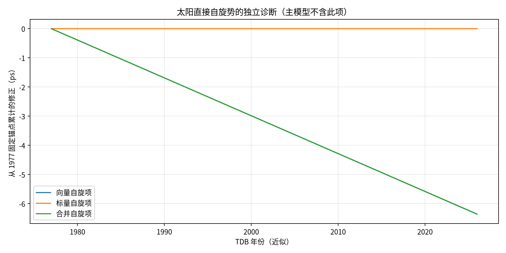
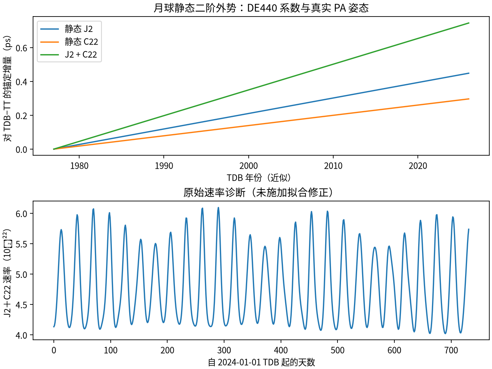

# TT–TDB 两个候选直接势的独立积分诊断

实算日期：2026-11-10。默认 Phase 1、Park 候选与已有验收结果均未更改。
本轮按用户要求仿照太阳 J2 双轴诊断，分别计算太阳直接自旋势和月球静态二阶外势。
所有修正从相同原始 IAU 1977 锚点积分；没有调零、重新锚定或拟合修正。

## 1. 实测结论

符号均为对 `Δ=TDB−TT` 的可加增量，单位 ps。
现代比较区间为2024-01-01至2026-01-01，含端点732个每日TDB历元。

| 独立贡献 | 锚点→2024-01-01 | 锚点→2026-01-01 | 现代最大绝对速率 |
|---|---:|---:|---:|
| 太阳直接自旋，标量+向量 | −6.097405778 | −6.357068818 | 4.323605154×10⁻²¹ |
| 月球静态 J2 | +0.430303969 | +0.448629954 | 3.668932066×10⁻²² |
| 月球静态 C22 | +0.284630635 | +0.296746689 | 2.426814600×10⁻²² |
| 月球静态 J2+C22 | +0.714934604 | +0.745376642 | 6.095746666×10⁻²² |

太阳自旋在几十年累计尺度不能据瞬时速率直接忽略，月球静态形状项也接近1ps预算。
但它们是否进入DE440原始时间模型仍未知；物理贡献可测不等于应加入JPL复现候选。

## 2. 固定物理来源与范围

### 太阳直接自旋

[solar_spin.py](../src/tt_tdb/solar_spin.py)依据固定Turyshev v2式(A5)、(A8)、(A9)、(A33)、(A34)：

\[
\delta F_{\rm spin}=-\frac{2(G\boldsymbol S_\odot)\cdot
[\boldsymbol r\times(\boldsymbol v_E-\boldsymbol v_\odot)]}{c^4r^3}.
\]

标量、向量分别积分，并与相对速度表达式独立重组核对。
采用原文 S=1.8838×10⁴¹ kg m²/s、NIST CODATA2022的G、Park2021 Sec.3.4太阳极轴。
原S来源是恒星结构惯量计算，不是已确认的DE440拟合参数，且未取得其误差。
GS的TDB尺度解释和未缩放敏感度均明确记录；两者累计差最大1.97135×10⁻¹⁹s，
不能解释本次ps级效应。G的单独标准不确定度敏感度约1.43×10⁻¹⁶s，不能充当总误差界。
完整来源、尺度与限制见[参数记录](sources/solar_spin_parameters.reference.md)。

区间末点（2026-01-01）向量贡献−6.357053468ps、标量贡献−0.00001535009ps。
真实轨道的LT摄动与直接自旋时间势分开处理，没有再次传播或修正轨道。



### 月球静态二阶外势

[lunar_multipole.py](../src/tt_tdb/lunar_multipole.py)使用同套DE440轨道、GM和header系数，
配套NAIF真实PA姿态核及`MOON_PA_DE440`帧。J2M=2.03214360135×10⁻⁴，
C22M=2.2380850528171017×10⁻⁵，AM=1738km；采用未归一化系数、C20=−J2，
不含Condon–Shortley相位。姿态不是同步旋转示意模型，也不是IAU_MOON近似。

主结果只含静态J2+C22。C21/S21/S22另列为字面静态敏感度，其确切物理角色尚未完整核实；
不能用该敏感度总和替代主结果。没有恢复完整潮汐/转动变形、degree≥3或多极PN项，
故本实验不是完整瞬时月球重力场。输入下载、SHA、惯量关系和归一化证据见
[月球来源记录](../data/phase2_lunar_multipole_provenance.md)。



## 3. 独立数值核查

- 同一边界 `T0_TDB`，对候选修正的锚点值严格为0，不再添加一次TDB0。
- 太阳：GL24/半日、Romberg6/半日、GL16/一日，全部从原锚点累计；
  所有通道最大独立求积差约8.08×10⁻²⁸s。scalar+vector与相对速度积分闭合约10⁻²⁷s。
- 月球：GL24/半日、Romberg8/半日、GL24/一日；主通道独立求积差分别
  1.06023×10⁻²⁷s和1.00974×10⁻²⁸s。用130点（含PCK边界）对照官方CSPICE，
  最大矩阵元素差2.86×10⁻¹²、方向向量差1.16mm；这不代表轨道物理不确定度。
- 实际运行太阳约31.77s、最终月球约8.61s。JSON记录源码/数据SHA、方法、软件版本和命令。
- 主session全套验证：`.venv/bin/python -m pytest -q`，**71 passed in 0.99s**。
  新测试分别覆盖自旋符号/共同速度抵消/尺度旋转不变性，以及月球势主轴极值、
  惯量关系、真实姿态与分段边界。

这些独立方法的差衡量数值一致性，不证明物理模型或源参数的绝对准确度。
月球统计helper另列的斜率/去趋势RMS仅为诊断，未对原始数列或验收施加修正。

## 4. 与既有SB441诊断的原始残差叠加

下面只做明确标记的后处理：旧混合SB441诊断加新候选增量，仍非完整DE440恢复。
叠加前核对产生程序源码SHA、数据身份、原始锚点和全部732个历元；太阳诊断还重核旧完整
Park模型签名、SB441输入、原参考值，并独立重积太阳J2轴差。

| 叠加配置 | 太阳赤道J2轴 max\|raw residual\| (ps) | 字面黄道J2轴 max\|raw residual\| (ps) |
|---|---:|---:|
| 原混合SB441诊断 | 2.818950 | 1.953520 |
| 仅加太阳直接自旋 | 9.176018 | 8.308583 |
| 仅加月球静态J2+C22 | 2.073573 | 1.238445 |
| 两候选同时加入 | 8.430642 | 7.563206 |

太阳自旋使对DE440的符合度变差；月球静态外势缩小差值，但两种轴均未达到1ps。
不能因为某项缩小或增大残差就反向选择物理项或参数。
本轮没有唯一定位旧约2ps的来源，也没有修改默认候选或宣布通过验收。

完整后处理结果：[JSON](../results/tables/phase2_additional_potentials_overlay.json)、
[CSV](../results/tables/phase2_additional_potentials_overlay.csv)。
各候选独立结果：[太阳](../results/tables/phase2_solar_spin_diagnostic.json)、
[月球](../results/tables/phase2_lunar_multipole_diagnostic.json)。

## 5. 复现与月球下一阶段

取得已记录的NAIF PCK/FK后，运行：

```sh
.venv/bin/python scripts/compare_phase2_solar_spin.py
.venv/bin/python scripts/compare_phase2_lunar_multipole.py
.venv/bin/python scripts/summarize_phase2_additional_potentials.py
.venv/bin/python -m pytest -q
```

月球扩展的独立参考与验收对象见[比较方案](lunar_validation_plan.md)：
先比较月心TCL−TDB与实际发布LTE440完整函数，周期项和线性项均恢复；
TL缩放及具体钟固有时另行定义。本轮只制定方案，未实现TCL或TL。
