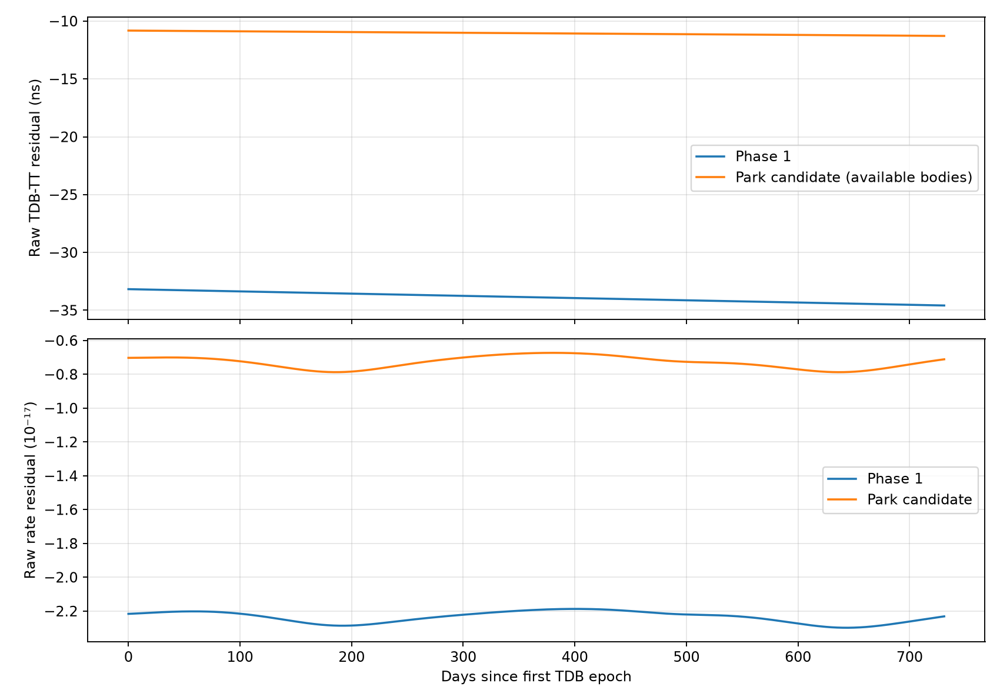
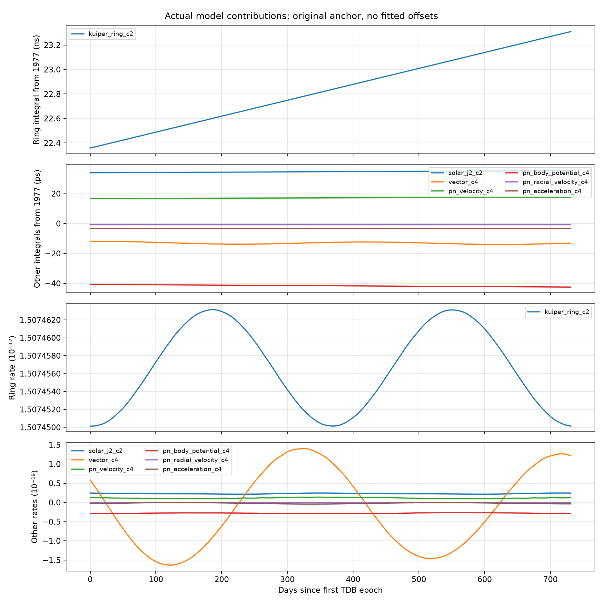
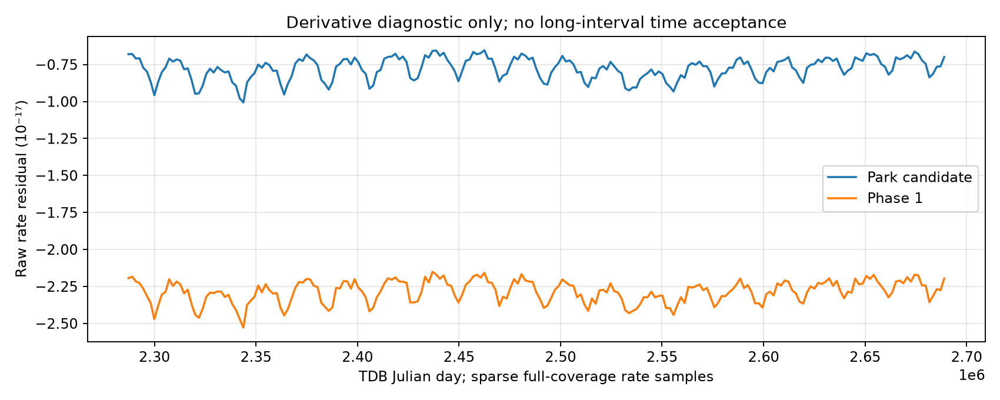
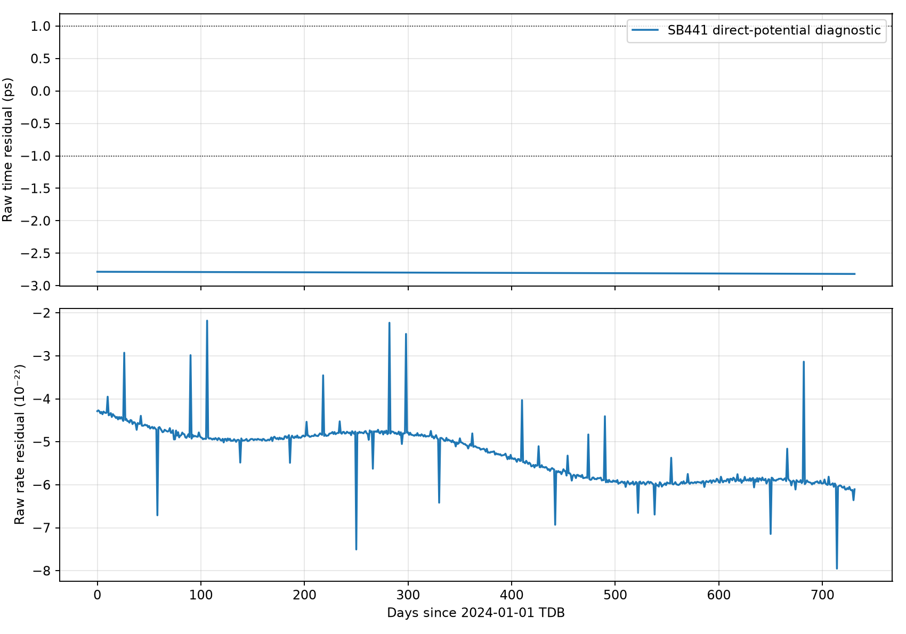
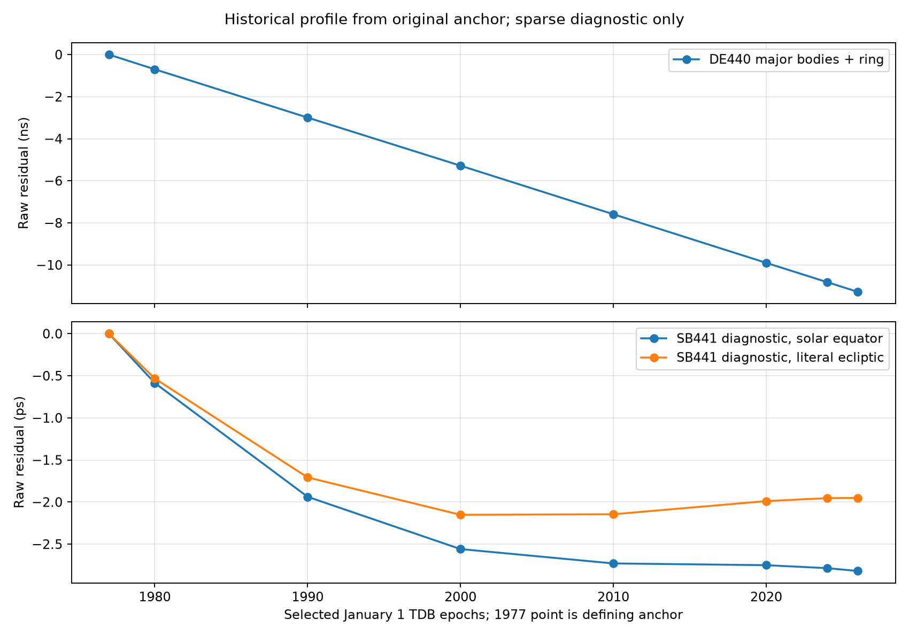

# Phase 2：地心 DE440 时间星历的独立复现

本阶段从固定的 IAU 1977 历元独立积分 Park et al. (2021) 的地心公式；保留 Turyshev 式 (21) 的原实现和所有原有 Phase 1 结果。最终验收只使用原始的 `模型−de440t` 差值，任何诊断拟合均不进入模型或验收。**严格 DE440 候选尚未达到 1 ps：2024-01-01 至 2026-01-01 的 732 个每日样本最大原始残差为 11.282037595 ns，RMS 为 11.050990058 ns。** 另用官方 SB441 实际小天体轨道和 DE440 GM 做明确标记的混合输入诊断，原始最大残差降至 2.818949569 ps；按 Park 2021 字面黄道纬度定义的预声明诊断为 1.953519690 ps。**两者也都未通过 <1 ps 门槛**，且不是原始 DE440 全状态恢复。没有调零或去趋势。

研究对象始终为地球质心的 `Δ=TDB−TT`。数值复现精度、物理模型完整性和轨道数据的物理不确定度是三个不同问题。

公式的完整逐项对应、单位和缺失数据见 [phase2_model_mapping.md](phase2_model_mapping.md)。实际计算程序为 [compare_phase2_jpl.py](../scripts/compare_phase2_jpl.py)，每个实验产物包含软件版本、源码与数据 SHA256、积分配置和独立参考段号。

## 原始资料和计算边界

本次阅读了 Turyshev v2 的式 (13)、(21) 与 Appendix A31–A42，LTE440 v1 的 Section 3 和 Figure 1，以及 Park 2021 的 Section 2.3、式 (3)–(7) 和有关动力学章节。Park PDF 的获取、15 页验证、SHA256 与 CC BY 4.0 归属记录见 [来源记录](sources/park_2021_de440_de441.reference.md)。论文作者为 Ryan S. Park、William M. Folkner、James G. Williams、Dale H. Boggs；*The Astronomical Journal* 161:105 (2021)，[DOI](https://doi.org/10.3847/1538-3881/abd414)。本项目保存原 PDF，并独立实现公式。

LTE440 作者报告的全覆盖小于 1 ps 是他们在取得小天体等轨道数据后进行的数值一致性实验。其月球时间星历的物理精度不能由 Figure 1 的地心数值残差直接推出。本文也不复制其公开仓库中缺少明确许可的代码。

DE440 几何状态和配套 GM 在 ICRF/J2000 下为 TDB-compatible，输入及积分变量均为 TDB 秒；不加光行时或恒星光行差。所有内部状态、GM 与势统一为 SI。地球自势不进入外部势，但地球 GM 必须进入式 (7) 的内层势求和。

真实 JPL 对照是 `de440t.bsp` 的 Type 2 段 `(1000000000,1000000001)`。特殊 X 分量是 **TT−TDB 秒**；本项目输出取负号，不把它当作 km。参考速率来自 Chebyshev 系数的解析导数并除 86400；现有独立 SPICE 测试同时检查时间差与速率。参考模块不被物理 integrand 导入。

## 从 Phase 1 到扩展模型

令外部单极势为 `U`，外部向量势为 `w`，式 (7) 的标量修正为 `D`。在地心处令观测点相对地心位置严格为零，Park 式 (3) 化为

\[
\Delta(t)=\mathrm{TDB}_0+A\int_{t_0}^{t}\left[
\frac{v_E^2/2+U+w_L}{c^2}
+\frac{v_E^4/8+3v_E^2U/2-U^2/2-4\boldsymbol v_E\!\cdot\boldsymbol w-D}{c^4}
-C_{\rm exact}\right]dt.
\]

其中 `A=(1−LG)/(1−LB)`、`C_exact=(LB−LG)/(1−LG)`，锚点仍为 `t0=T0+TDB0`，`TDB0=−65.5 μs`。没有用经验平均 `LC` 替换 IAU 定义常数，没有参考拟合或历元重置。

[extended_ephemeris.py](../src/tt_tdb/extended_ephemeris.py) 在独立的新 reader 中解析同一 DE440 Type 2 位置多项式，并用两次求导的 Clenshaw 递推获得外部天体的重心速度、加速度。加速度来自真实星历多项式，不以二体轨道或牛顿力替代。原 [ephemeris.py](../src/tt_tdb/ephemeris.py) 未改写，Phase 1 状态路径仍保留。

[jpl_model.py](../src/tt_tdb/jpl_model.py) 保持原有 `[F2−C,F4]` 接口，同时输出每项诊断速率和明确开关。新增可单独测试的贡献包括太阳 J2 势、`−4vE·w/c⁴` 向量项、式 (7) 的外部天体速度平方项、天体处的内层势项、径向速度项与加速度项。实际可得天体是太阳、月球、其余七行星和冥王星系统；卫星质量不重复叠加。每个添加项的数值影响通过独立积分通道记录。

太阳 J2 使用 DE440 header 的 `J2SUN`、`ASUN` 和 Park Section 3.5 的太阳自转轴。原式 (5) 的文字把纬度称为“ecliptic”，与该节对太阳轴的描述存在约定疑问；后续实际阅读的 [Folkner et al. 2014 原始 DE430/431 报告](https://ipnpr.jpl.nasa.gov/progress_report/42-196/196C.pdf)，Sec. II.C、式 (7) 明确把该纬度定义为相对太阳赤道，支持当前太阳自转轴实现。这一原文交叉证据与 Park 的措辞差异均明确记录，未根据 JPL 残差选择轴方向。轨道摄动中的太阳角动量和太阳辐射压力不能自动转化成额外直接时间势项；没有凭猜测添加论文式 (3)–(7) 未指定的项。

此外，模型现在用 Park Section 2.2 明确发表的 **36 个等质量质点、日心 44 AU、黄道平面** 环及 DE440 header 中的 MA8201–MA8236 GM，实际计算环的 leading 直接势。黄道平面取 SPICE `ECLIPJ2000`，太阳位置随真实 DE440 运动，距离逐节点计算；这不是把 44 AU 的数量级估计当作最后修正。环相位显式设为零，均匀 36 点的潜势对相位差具有几何级数上界；代码测试验证，在同样的等距圆形固定几何下，仅整体相位选择造成的潜势差在 1100 年累计中远小于 1 ps；这不是环真实轨道演化、径向变化或极轴不确定性的上界。未取得原环速度、加速度时，不凭空添加环的向量势、混合 c⁻⁴ 与式 (7) 贡献，模型的缺失清单仍保留这些项。

## 数值积分与验证

首先重跑原 47 项测试，全部通过，耗时约 0.39 s；加入每个新物理项、开关、header 参数、SPK 解析导数及环相位界的测试后，全套 **61 项测试通过**，约 1.31 s，包含 373 小天体输入的独立 SPICE 核验；数据和依赖在本环境中均可用。把 DE440、GM、JPL 时间参考与小天体文件的环境路径显式指向不存在的位置后，53 项通过、8 项真实数据测试明确跳过，约 0.49 s；不会静默替换为玩具轨道。日志为 [全测试](../results/tables/phase2_tests.log) 与 [无内核测试](../results/tables/phase2_tests_without_kernels.log)。随后重跑 Phase 1 的短区间收敛和完整 1977→2026 积分；新日志性结果保存在 `results/tables/phase2_baseline_*`，原 Phase 1 已提交产物保持不变。

Phase 1 冷积分使用 35793 个半天段；Romberg 10 层总计 18737838 个节点，约 74.4 s；独立 Gauss–Legendre 16 阶约 4.07 s。732 个每日样本上的最大原始时间残差为 **34.585021534 ns**，RMS **33.879534774 ns**，最大速率残差为 **2.298682034×10⁻¹⁷**。Romberg 与 Gauss 时间差最大 **6.071532166×10⁻¹⁸ s**；它证明积分一致性，不能证明遗漏的物理项为零。

Phase 2 先在 2024 年现代 32 天区间比较半天/一天 Romberg 10 层与半天/四分之一天 Gauss 16/24 阶。然后一次从原锚点积分所有通道：原 Phase 1 的 `[F2−C,F4]`，加上各物理增量。这样既能测定各项从 1977 累积的贡献，又能逐项消融，无需为每个关闭开关的模型重复几十年冷积分。原 kinetic 与 scalar leading terms 不分别积成大数再相减；小量始终作为独立通道保留。

累计积分使用既有补偿求和缓存；源码、数据、开关、太阳轴、通道名和算法版本均进入指纹。不同物理配置拒绝读取旧缓存。双部分 JD 用于历元表示，不以两个完整 float64 JD 相减检验皮秒精度。

完整独立对照是半天 Romberg 10 层与半天 Gauss 24 阶，均从同一个原锚点开始，均不引用 JPL 时间星历作为边界。reference 只在模型完成后读取，以取得 `R_time` 和 `R_rate`。

## 实测结果与图表

最终原始 residual、速率和逐项贡献以 [phase2_jpl_comparison.json](../results/tables/phase2_jpl_comparison.json) 及 [每日 CSV](../results/tables/phase2_time_series.csv) 为准。以下均为原始误差，没有常数对齐或线性趋势消除。

| 实测模型，均从固定 1977 锚点积分 | 最大绝对时间残差 | RMS 时间残差 | 最大绝对速率残差 |
|---|---:|---:|---:|
| 原 Phase 1：Turyshev 式 (21) | 34.585021534 ns | 33.879534774 ns | 2.298682034×10⁻¹⁷ |
| 主要天体的 J2、向量势和补充 PN 项，暂未加环 | 34.591851594 ns | 33.886419705 ns | 2.294818164×10⁻¹⁷ |
| 上述扩展项加发表的 36 点环 leading 势 | **11.282037595 ns** | **11.050990058 ns** | **7.873608610×10⁻¹⁸** |
| 要求 | 严格 <0.001 ns | 报告实测值 | 报告实测值 |

加入 J2 与完整 major-body PN 项并没有自动改善验收误差：这些项相互抵消，2026 年的合计改变量为约 −6.83006 ps，最大原始残差反而略增。加入实际发表环的直接势后，2026 年修正为 +23.309813999 ns，降低了大部分误差；这次计算提供了之前约 23 ns 数量级的实际模型证据，同时明确说明它不能解释全部约 35 ns 残差。

最终半天 Romberg 10 层冷启动约 224.88 s，独立 Gauss 24 阶约 11.73 s，总实验约 237.22 s。两方法在 732 点上的最大时间差为 **2.818925648×10⁻¹⁸ s**。32 天短区间中，Romberg 半天/一天与四分之一天 Gauss 24 的最大差分别约为 1.0842×10⁻¹⁹ s、1.6263×10⁻¹⁹ s；Gauss 16 半天最大差约 5.4210×10⁻¹⁹ s。

另外运行 [check_phase2_direct_integrand.py](../scripts/check_phase2_direct_integrand.py)，直接对最终 `JPLModel.__call__` 的两个通道从 1977 积分，而不使用 baseline 加各增量的重组路径。其 Gauss 24 结果与重组 Gauss 24 的最大差为 **8.109832250×10⁻¹⁷ s（0.0000811 ps）**。差异主要来自扩展 reader 与原 Phase 1 reader 的等价多项式计算舍入顺序，以及通道相加顺序；远小于目标阈值。完整检查见 [直接积分核对](../results/tables/phase2_direct_integrand_check.json)。这项检查覆盖全部 47 年锚点累计，不能与现代短区间的 rate closure 混为一谈。

原始残差从首点 −10.821223732 ns 变为末点 −11.282037595 ns，现代区间峰峰变化为 0.460813862 ns。平均速率残差约 −7.295850814×10⁻¹⁸，支持它主要含未补齐直接势产生的持续负漂移；仍有小幅周期结构。**仅作诊断**的线性拟合斜率约 −0.626562 ps/day，拟合后 RMS 约 2.091690 ps；既不使用这个拟合校正模型，也不以它替代原始 11.282 ns 验收值。



每个新增物理项都实际积分，下面的速率最大值取现代 732 个样本并包含 A 缩放；累计值来自原 1977 锚点。最后一列定义为 `max|R_without|−max|R_with|`，**正值表示加入该项降低最大误差，负值表示升高最大误差**，不是非负范数。所有项的无项 time/rate residual 还保存在 JSON 中。

| 新项 | 现代最大绝对 Δ 速率 | 锚点→2024-01-01 | 锚点→2026-01-01 | 现代区间累计峰峰变化 | 对最大残差的改善 |
|---|---:|---:|---:|---:|---:|
| 太阳 J2，式 (5) | 2.458847×10⁻²⁰ | +33.978069 ps | +35.425062 ps | 1.446993 ps | +35.425062 ps |
| 36 点 Kuiper 环 leading 势，式 (4)/Sec. 2.2 | 1.507463×10⁻¹⁷ | +22.357728491 ns | +23.309813999 ns | 0.952085508 ns | +23.309813999 ns |
| 外部向量势，式 (6) | 1.630251×10⁻¹⁹ | −12.059350 ps | −13.189537 ps | 1.993486 ps | −13.189537 ps |
| 式 (7)：外部天体速度平方 | 1.399184×10⁻²⁰ | +16.799755 ps | +17.529120 ps | 0.729365 ps | +17.529120 ps |
| 式 (7)：天体处的内层势 | 2.940368×10⁻²⁰ | −40.768552 ps | −42.533044 ps | 1.764492 ps | −42.533044 ps |
| 式 (7)：径向速度平方 | 1.090258×10⁻²¹ | −0.759006 ps | −0.790991 ps | 0.031985 ps | −0.790991 ps |
| 式 (7)：加速度 | 4.132378×10⁻²¹ | −3.143879 ps | −3.270670 ps | 0.126792 ps | −3.270670 ps |

J2、向量势及 PN 项的状态和 GM 均来自同一 DE440，参数来自其 header 与原论文；其数据物理协方差尚未取得。环质量同样来自 header，几何和离散点数来自 Park 原文，缺失的动态/高阶项仍显式标记。不能从这些归因数值推断它们的物理参数绝对精度。



共同覆盖 JD 2287184.5–2688976.5，约 1550–2650 年。221 个实际全覆盖稀疏 rate 样本的扩展模型最大绝对速率残差为 **1.006888491×10⁻¹⁷**；它证明残余速率偏差并非仅现代两年偶然事件。由于现代目标未达成，**没有执行并宣称 1100 年完整时间积分验收通过**。



## 太阳 J2 纬度定义的独立诊断

两份原始 JPL 文献对同一纬度变量给出不同文字定义：Folkner 2014 式 (7) 采用太阳赤道，Park 2021 式 (5) 采用日心黄道纬度。当前默认实现按前者与太阳自转轴几何；对后者也用 SPICE `ECLIPJ2000` 的黄道法向量实际计算。两个轴由原文提前固定，没有连续调整轴方向去拟合参考。

[compare_phase2_solar_axis.py](../scripts/compare_phase2_solar_axis.py) 从相同 1977 锚点独立积分两种 J2 势。黄道定义减赤道定义的累计差在 2024 首点为 **+0.8320169925 ps**，2026 末点为 **+0.8674357973 ps**；现代最大速率差为 **1.148961973×10⁻²¹**。独立 Gauss 24 与 Romberg 8 的每一通道最大差均为 6.46×10⁻²⁷ s，两种纬度定义之差的独立积分核对最大差也是 6.46×10⁻²⁷ s。结果保存在 [轴定义诊断 JSON](../results/tables/phase2_solar_axis_diagnostic.json) 与相应 CSV。

这一影响已经达到 1 ps 目标的量级，因此不能忽略原文中的纬度约定。诊断不修改主模型，也不因看到哪条曲线更接近参考就选择哪条；即使某一诊断达到数值阈值，原始 JPL 实现使用的约定仍须凭明确来源确认。

## 实际小天体轨道的混合输入诊断

取得并核验 JPL 官方 `sb441-n373s.bsp` 后，[small_body.py](../src/tt_tdb/small_body.py) 读取其实际 343 个小行星和 30 个 KBO 的日心 ICRF 几何位置，计算相对 DE440 地球日心位置的距离。[Farnocchia IOM 392R-21-005](sources/sb441_perturbers.pdf) 的 373 个目标身份和完整 GM 逐项与 DE440 header 交叉匹配；KBO 身份必须一一唯一对应，不能缺项或重复。计算 GM 始终取 DE440 header，没有调质量去匹配时间残差。输入与 mapping 记录见 [小天体来源](../data/phase2_small_body_provenance.md)。

**SB441 的轨道是相对 DE441 行星重新拟合、重新积分的轨道，不能标成原始 DE440 小天体积分状态。** 因此这是一组独立、明确限定的物理来源诊断，未自动替代默认模型的数据。只添加实际直接标量 leading 势，向量与额外 PN 项继续列为缺失。

[compare_phase2_small_bodies.py](../scripts/compare_phase2_small_bodies.py) 从同一 IAU 锚点独立积分两个通道，而后与已实测的扩展候选组合；参考时间数据仅在完成模型积分后读取。半天 Gauss 24 与半天 Romberg 6 的小体累计差最大为 **1.654361225×10⁻²⁴ s**，半天 Gauss 24 与一天 Gauss 16 的最大差也是同量级。整个诊断冷启动约 308.15 s；具体配置和哈希见 [诊断 JSON](../results/tables/phase2_sb441_diagnostic.json)。

| 实际添加的直接势 | 现代最大绝对 Δ 速率 | 锚点→2024-01-01 | 锚点→2026-01-01 | 现代累计峰峰变化 | 加入该项降低的最大误差 |
|---|---:|---:|---:|---:|---:|
| 343 个小行星 | 5.260694×10⁻¹⁸ | +6.998059851 ns | +7.293837814 ns | 0.295777962 ns | +7.293837814 ns |
| 30 个 KBO | 2.617012×10⁻¹⁸ | +3.820378484 ns | +3.985380831 ns | 0.165002347 ns | +3.985380831 ns |

这两个已计算项解释了候选剩余约 11.28 ns 的绝大部分；它们的变化结构也解释了现代的主要 rate residual。它们与环的 23.31 ns 贡献必须分别列出，不能都归到同一个假设环模型。

| 混合 SB441 输入的预声明纬度模型 | 732 点最大原始残差 | RMS 原始残差 | <1 ps 是否通过 |
|---|---:|---:|---|
| 太阳赤道，Folkner 2014 定义，默认轴 | **2.818949569 ps** | **2.801277756 ps** | 否 |
| 黄道，Park 2021 式 (5) 字面定义 | **1.953519690 ps** | **1.950451572 ps** | 否 |

默认轴的最大速率残差为 **7.951273638×10⁻²²**，平均约 −5.303039667×10⁻²²。其时间 residual 从 −2.785396737 ps 变到 −2.818949569 ps。黄道定义的 residual 在 −1.953519690 至 −1.948163081 ps 之间，现代峰峰变化仅 **0.005356609 ps**，仍留近常数偏差。不能把约 1.95 ps 减掉后宣布通过。

已对“把缺失的小体直接 U 代入原 mixed/squared c⁻⁴ 项”做单独的现代瞬时灵敏度计算，其最大速率仅 **3.921215532×10⁻²⁶**，比目前最大 rate residual 小约两万倍。它没有进入诊断模型，也不是 47 年累计误差界；但不能没有量级证据就把剩余约 2 ps 归因为这个 mixed 项。其它尚未恢复的 PN/输入约定仍为未解决项，没有被证明独自解释这一偏差。



## 少量历史历元的误差累计剖面

为了检查近常数的现代偏差何时已累计，[phase2_history_profile.py](../scripts/phase2_history_profile.py) 复用通过完整指纹验证的 major-body 与小体 Gauss 24 缓存，在固定原锚点以及 1980、1990、2000、2010、2020 等少量历元读取原始时间 residual。太阳纬度之差另行独立积分。所有公历点为 1 月 1 日 00:00 TDB；2000-01-01 此点不是 J2000 正午。

| 固定 TDB 历元 | 原 major+ring 候选 residual (ns) | 混合 SB441，太阳赤道 (ps) | 混合 SB441，字面黄道 (ps) |
|---|---:|---:|---:|
| 1977 定义锚点 | 0.00000001774 | +0.00001774 | +0.00001774 |
| 1980-01-01 | −0.699515709 | −0.585830253 | −0.532741433 |
| 1990-01-01 | −2.994975397 | −1.937700881 | −1.707590707 |
| 2000-01-01 | −5.281989964 | −2.558537488 | −2.151414829 |
| 2010-01-01 | −7.590124336 | −2.729262752 | −2.145099080 |
| 2020-01-01 | −9.901087494 | −2.750065028 | −1.988867729 |
| 2024-01-01 | −10.821223734 | −2.785399041 | −1.953382050 |
| 2026-01-01 | −11.282037597 | −2.818952266 | −1.951516463 |

现代两行采用这一历史脚本的独立 Gauss 路径，与主表 Romberg 路径只差几 attoseconds。完整 JSON/CSV 见 [历史剖面](../results/tables/phase2_history_profile.json)。从锚点的约零误差，到 1980、1990 已有明显小量，再到 2000 约 2 ps，表明现代近常数偏差并非凭空的自由历元常数；它是在原始累计过程中形成的。该剖面有助于后续定位较早时段的小体输入与参数约定，却不能仅凭曲线把原因证明为某一个遗漏项。

这是少量固定历元诊断，**不是 1100 年每日完整时间验收**。



## 未解决的数据与误差来源

轨道已经受小天体摄动，并不等于 `GM/r` 直接势已存在于时间 integrand。已公布的 DE440 header 包含 343 个小行星 GM、30 个单独 KBO GM 与 36 个环质点 GM；常规行星 `de440.bsp` 没有相应状态段。任何未取得与 DE440 一致的实际状态都不能用假设距离、示意轨道或另一套 GM 替代并宣称物理补齐。

还有一个独立参数约定问题：真实 DE440 header 和 BSP 注释列有 `GMSDOT=−9×10⁻¹⁴` 以及 `JDEPOC=2440400.5`，但已核实的 Park 原文与 BSP 注释没有给该字段的单位、太阳 GM 的定义 epoch，以及它是否进入时间势积分。Folkner 2014 描述的是当时固定的太阳 GM，不能直接作为 DE440 新参数的使用证明。本文没有把它擅自解释为每年的分数变化并修正残差；后续需取得 JPL 对该参数时间规律的明确说明。

数值积分差异由独立 quadrature 衡量；遗漏物理模型主要由直接小天体势及待核对的约定决定；输入星历本身的轨道/质量物理不确定度不从两种积分方法的一致性中推断。本阶段不会把条件式 44 AU 环的数量级估计直接归因为之前约 35 ns 的总残差。

现代 interval 只有在原始最大差严格小于 `1e−12 s` 后才可宣称达到主要目标。长覆盖的稀疏速率诊断只检查实际覆盖和时间依赖，不是 1100 年完整积分验收；现代验收失败时不宣称长时段通过。

## 复现命令

```sh
.venv/bin/python scripts/download_data.py --phase2-small-bodies
.venv/bin/python -m pytest -q
.venv/bin/python scripts/run_experiment.py
.venv/bin/python scripts/compare_phase2_jpl.py --no-cache
.venv/bin/python scripts/check_phase2_direct_integrand.py
.venv/bin/python scripts/plot_phase2_terms.py
.venv/bin/python scripts/compare_phase2_small_bodies.py --no-cache
.venv/bin/python scripts/compare_phase2_solar_axis.py
.venv/bin/python scripts/phase2_history_profile.py
```

正常后续复现可省略 `--no-cache`，缓存仍必须通过完整指纹验证。大型 BSP 文件继续忽略，不提交 Git。
