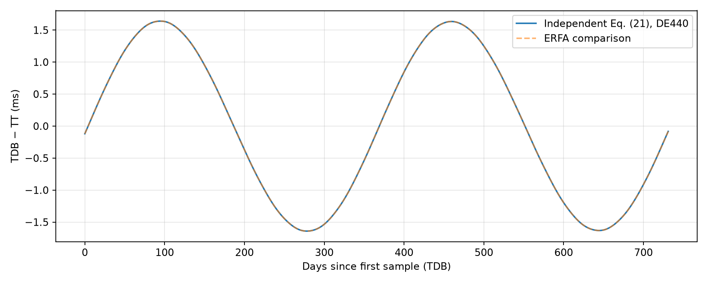
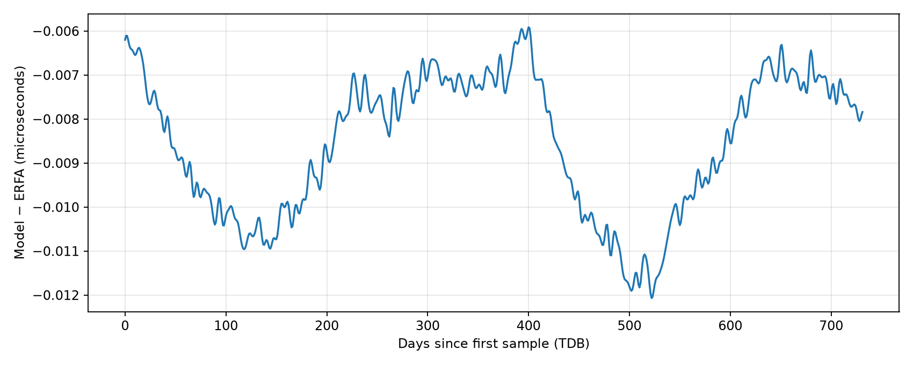
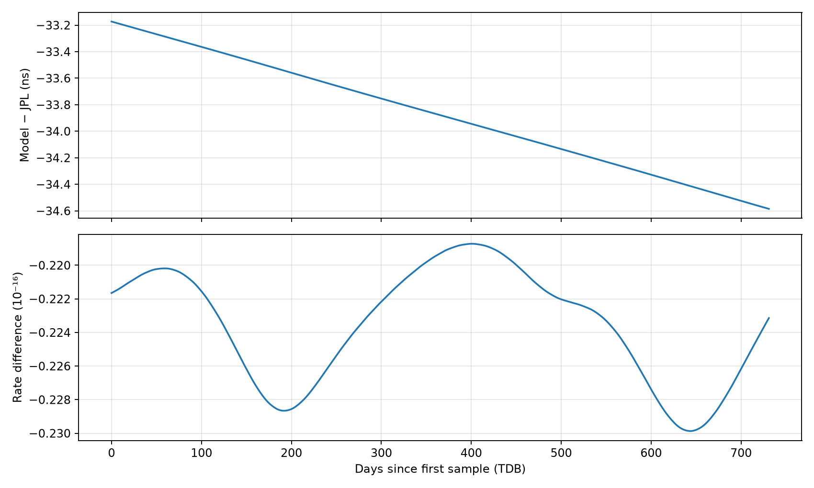
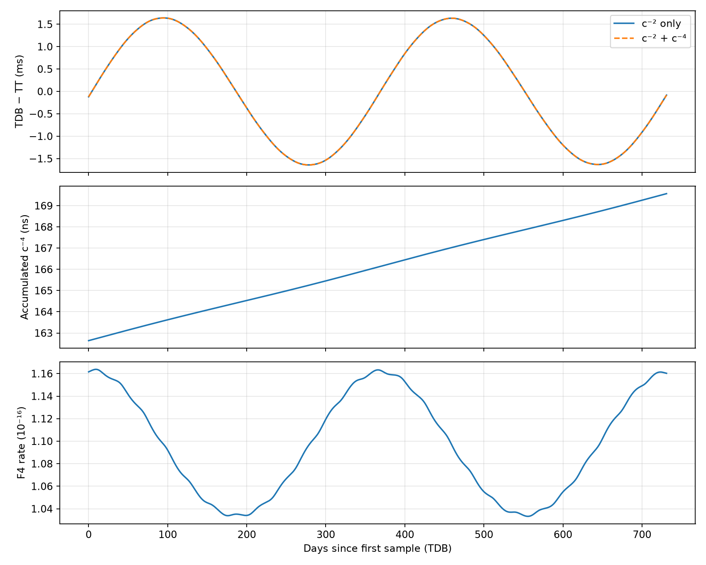
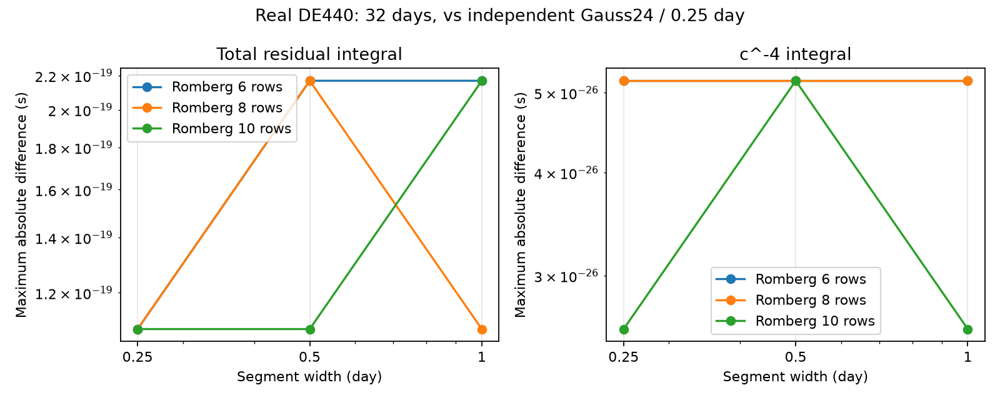
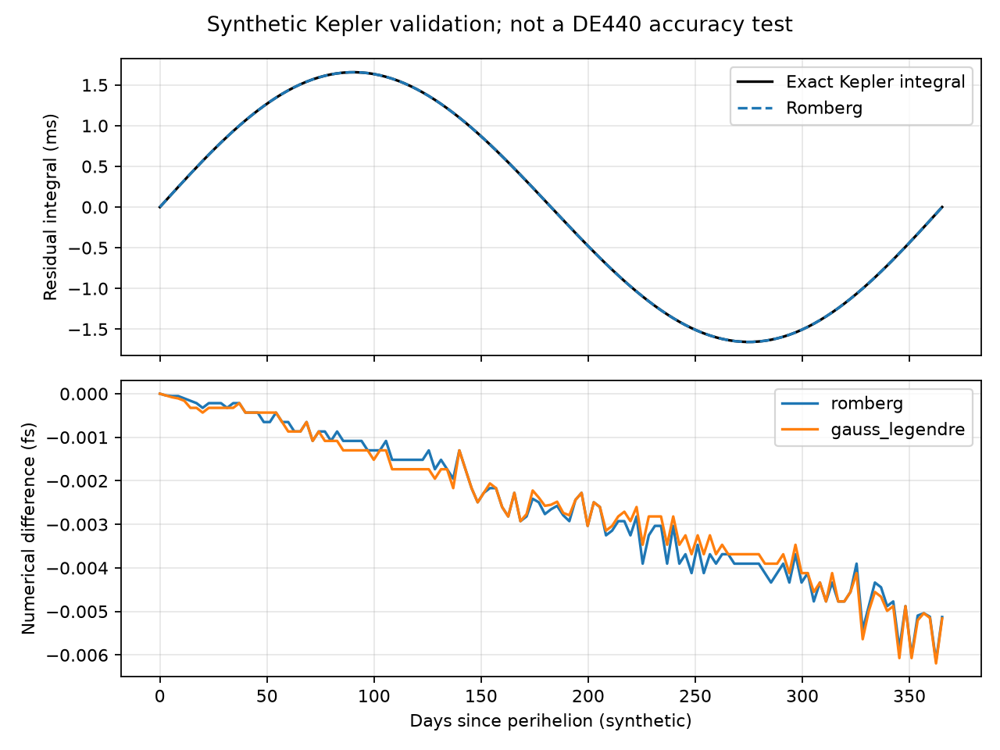

# 地心 TT↔TDB：从相对论公式到 DE440 数值实验

本讲义对应根目录 `guild.md`。研究对象严格限定为地球质心世界线，时间差符号统一为 $\Delta=\mathrm{TDB}-\mathrm{TT}$，单位为秒。核心链路从真实 DE440 位置、速度和 GM 独立积分，ERFA 与 JPL 数值时间星历用于对照。本地用户论文为 v3；任务要求的 v2 已另外下载、固定哈希并视觉核对，详见 [资料与阅读记录](source_notes.md)。

## 第一章：研究问题

坐标时是给时空事件标记时间的坐标；固有时是沿特定世界线的理想钟所积累的时间。它们在相对论中扮演不同角色。太阳系质心参考系 BCRS 使用 TCB，地心参考系 GCRS 使用 TCG。TT 是按固定定义常数缩放的 TCG，TDB 是按另一个固定定义常数缩放并平移的 TCB。因此不能把 TT 或 TDB 简单等同于某一只原子钟的固有时，也不能认为不同尺度的数值标签不同就意味着两个事件不同。

地球的轨道速度与太阳等外部天体的引力势随时间变化。速度越大，运动时钟相对于质心坐标时的速率越慢；外部引力势越深，也会影响地心坐标时相对于质心坐标时的速率。对椭圆轨道，地球接近近日点时速度和太阳势都增大。这种速率差经过积分，产生毫秒量级的年度时间差。

这里的“地心”是观测点相对于地球质心的位置 $\boldsymbol r_E=0$。地球在太阳系质心系中的轨道位置 $\boldsymbol x_E$ 与速度 $\boldsymbol v_E$ 仍然非零。程序区分这两个向量，不把地球从轨道中删除。

## 第二章：从式 (13) 到式 (21)

### 2.1 速率的物理来源

在弱场、低速条件下，后牛顿展开将运动学和引力修正按 $c^{-2},c^{-4},\ldots$ 排序。式 (13) 表达 TCG 与 TCB 的关系：沿地球轨道积分一个包含动能和外部势的速率，并加入观测位置相关的同时性修正。地心条件使所有包含 $\boldsymbol v_E\cdot\boldsymbol r_E$ 的位置项为零。

定义外部势

$$
U_{\rm ext}(t)=\sum_{B\ne E}\frac{GM_B}{|\boldsymbol x_B(t)-\boldsymbol x_E(t)|}.
$$

它的单位是 $\mathrm{m^2\,s^{-2}}$，与速度平方相同。地球自身不在求和中：式 (13) 处理参考系之间的变换，不能把地面自引力时间膨胀混入地心外部势。

本任务逐字实现论文式 (21) 指定的截断被积函数：

$$
F_2=\frac{v_E^2/2+U_{\rm ext}}{c^2},\qquad
F_4=\frac{v_E^4/8+3v_E^2U_{\rm ext}/2-U_{\rm ext}^2/2}{c^4},\qquad F=F_2+F_4.
$$

两者均无量纲，对时间积分才得到秒。阶数标记本身不能保证完整性：该 $F_4$ 是论文的特定近似，不能代替任意完整 N 体相对论时间模型。

### 2.2 定义缩放与数值稳定形式

TT 与 TCG 的缩放由精确定义常数 $L_G$ 给出；式 (20) 将 TCB 线性变换到 TDB，使用 $L_B,T_0,\mathrm{TDB}_0$。定义

$$
A=\frac{1-L_G}{1-L_B},\quad
C_{\rm exact}=\frac{L_B-L_G}{1-L_G},\quad
K=\frac{L_B-L_G}{1-L_B}=AC_{\rm exact},\quad
t_0=T_0+\mathrm{TDB}_0.
$$

$T_0$ 在文献中以 JD 表示，$\mathrm{TDB}_0$ 以秒表示，必须先将它们转换为同一单位。视觉核对 v2 PDF 第 7 页：式 (21) 的积分在大括号中为正号，**整个大括号前有负号**，因此两积分对 TT−TDB 的整体贡献为负。该符号与式 (13) 的变换链及题设残余式相容，无需修改原式。原始 PDF 截图见 [第 7 页](sources/eq21_v2_page7.png)，细节见 [模型审计](model_audit.md)。

从变换链推导的地心结构为

$$
\mathrm{TT}-\mathrm{TDB}=K(t-T_0)-A\,\mathrm{TDB}_0-A\int_{t_0}^{t}F(s)\,ds.
$$

取相反符号并代入 $t-T_0=(t-t_0)+\mathrm{TDB}_0$：

$$
\Delta=A\int F\,ds-K(t-t_0)+(A-K)\mathrm{TDB}_0.
$$

因为 $A-K=1$，得到程序使用的恒等式

$$
\boxed{\Delta(t)=\mathrm{TDB}_0+A\int_{t_0}^{t}[F(s)-C_{\rm exact}]\,ds.}
$$

这不是拟合或校准，而是精确的代数重写。它先去掉约 $10^{-8}$ 的平均速率，再积累较小的周期残差，避免积累几十秒后相减获取毫秒。边界条件严格为 $\Delta(t_0)=\mathrm{TDB}_0$，任何对照模型的常数差都会保留。

若为了周期分离使用别的平均数 $M$，必须恢复相应项：

$$
\Delta=\mathrm{TDB}_0+A\left[\int(F-M)\,ds+(M-C_{\rm exact})(t-t_0)\right].
$$

不恢复这一项会改变原始公式。特别是论文经验 $L_C$ 与由定义常数计算的 $C_{\rm exact}$ 并不完全一致，详见 [理论审计](model_audit.md)。

## 第三章：公式与代码逐项对应

以下片段来自项目真实代码。积分器接收两个独立通道 $[F_2-C_{\rm exact},F_4]$，这样比较阶次时不会通过两个大数相减提取小量。公式中除明确说明外，状态都在 TDB-compatible、几何 J2000/ICRF 系统中，单位为 SI。

### 3.1 `external_potential()`：构造外部势

**对应论文公式：** 式 (13)、(21) 中的求和。**物理意义：** 在地球质心计算其他天体的单极势，不计算地球自引力。**数学表达式：** $U_{\rm ext}=\sum_{B\ne E}GM_B/r_{BE}$。

**输入：** 地球位置 `earth_position`、外部天体位置字典 `body_positions`（m）、同名 GM 字典（m³/s²），形状可以是单点或数组。**输出：** 总势（m²/s²）；`breakdown=True` 同时返回逐天体贡献。**代码位置：** [potential.py](../src/tt_tdb/potential.py):`external_potential`。

```python
radius = np.linalg.norm(position - earth, axis=-1)
if np.any(radius <= 0):
    raise ValueError('External body coincides with Earth')
contributions[body] = mass/radius
total = np.sum(np.stack(list(contributions.values())), axis=0)
```

**数值处理：** 所有单位转换在星历层完成；函数拒绝 `earth`、`emb` 或对应编号作为外部天体，位置与 GM 键必须一致。**验证方法：** `test_potential_units_contributions_and_translation_invariance` 独立验证单体 GM/r、月球贡献、平移不变性和地球自势拒绝；真实 J2000 诊断检查太阳势约 $10^9$ m²/s²。

### 3.2 `rate_c2()`：主后牛顿速率

**对应论文公式：** 式 (21) 的 $c^{-2}$ 积分。**物理意义：** 地心轨道运动学项和外部势项共同改变坐标时速率。**数学表达式：** $F_2=(v_E^2/2+U)/c^2$。

**输入：** 速度平方（m²/s²）与势（m²/s²）。**输出：** 无量纲 $F_2$，单点或 NumPy 数组。**代码位置：** [pn_rate.py](../src/tt_tdb/pn_rate.py):`rate_c2`。

```python
return (0.5*np.asarray(velocity_squared)+np.asarray(potential))/C_LIGHT**2
```

**数值处理：** `float64`，保留独立物理项；约 $10^{-8}$ 的均值直到残余通道构建时才减掉。**验证方法：** `test_formula_against_high_precision_scalar_and_scaling` 用 60 位 mpmath 从独立标量公式计算参考值；`test_genuine_geocentric_rates` 检查真实星历的速度与势及速率数量级。

### 3.3 `rate_c4()`：保留指定的三项

**对应论文公式：** 式 (21) 的 $c^{-4}$ 积分。**物理意义：** 四次速度、动能与引力势耦合、势平方的修正。**数学表达式：** $F_4=(v_E^4/8+3v_E^2U/2-U^2/2)/c^4$。

**输入：** 同上。**输出：** 无量纲 $F_4$；本实验地球轨道上约 $10^{-16}$。**代码位置：** [pn_rate.py](../src/tt_tdb/pn_rate.py):`rate_c4`。

```python
v2, u = np.asarray(velocity_squared), np.asarray(potential)
return (v2*v2/8.0+1.5*v2*u-0.5*u*u)/C_LIGHT**4
```

**数值处理：** 注意第一项是 `v2*v2`，不是 `v2`；负号只作用于势平方。该截断公式并不包括完整外部向量势与其他 PN 标量势修正。**验证方法：** 同一个 mpmath 标量测试验证系数、符号和舍入误差；真实星历测试检查 $F_4/F_2$ 很小，但不把 $F_4$ 从长期积分中删除。

### 3.4 `relativistic_rate()` 和 `PNModel`：组合物理链路

**对应论文公式：** 式 (21) 的总被积函数。**物理意义：** 从真实轨道状态得到速率，再构造可积分的残差。**数学表达式：** $F=F_2+F_4$；两通道为 $(F_2-C_{\rm exact},F_4)$。

**输入：** `relativistic_rate` 接收 SI 速度平方和势、`include_c4` 开关；`PNModel` 接收 DE440 适配对象，调用时输入 J2000 起算的 TDB 秒。**输出：** 总速率或两个积分通道；`diagnostics` 另给速度平方、总势、逐天体势、太阳/其他势、F2/F4、比例与残余。**代码位置：** [pn_rate.py](../src/tt_tdb/pn_rate.py):`relativistic_rate`、`PNModel.diagnostics`、`PNModel.__call__`。

```python
v2 = np.sum(state.earth_velocity**2, axis=-1)
f2, f4 = rate_c2(v2,u), rate_c4(v2,u)
# PNModel.__call__:
return np.stack((d['F2']-C_EXACT,d['F4']),axis=-1)
```

**数值处理：** 模型拒绝非 TDB-compatible 标签，地心位置项在诊断中为精确的 `0.0`；核心模块没有导入 ERFA 或 JPL 时间参考。**验证方法：** `test_genuine_geocentric_rates` 以及星历适配的独立 SPICE 检查；c4 开关实验直接积分第二通道后分析贡献。

### 3.5 `integrate_rate()`：速率到时间差

**对应论文公式：** 式 (21) 的时间积分。**物理意义：** 无量纲速率乘以时间间隔并求积，获得秒。**数学表达式：** $I_k=\int_a^b R_k(t)\,dt$。

**输入：** 返回 NumPy 通道数组的速率函数、起止 TDB 秒、`method`、`order` 与通道数。**输出：** `IntegrationResult`，含秒单位积分值、经验误差指示、评估点数、层数与方法。**代码位置：** [integration.py](../src/tt_tdb/integration.py):`integrate_rate`、`_quadrature_intervals`。

```python
row.append(row[-1] + (row[-1] - previous[column - 1])
           / (4 ** column - 1))
# 独立 Gauss–Legendre 分支：
return widths[:, None] / 2 * np.einsum("n,mnk->mk", weights, values)
```

**数值处理：** Romberg 默认十行表，即每段 512 个梯形小区间、513 个评估点；Gauss–Legendre 使用独立节点与权重。两者共享物理速率，独立求积，并非互相调用结果。末两层差或高低阶差是经验指示，不是严格上界。**验证方法：** `test_independent_quadratures_analytic_polynomial` 检验解析多项式、反向和零宽积分；`test_romberg_order_convergence_to_mpmath` 检验独立高精度解析值；真实 DE440 收敛实验见第六章。

### 3.6 `SegmentedIntegrator`：从 1977 年建立一次累计积分

**对应论文公式：** 式 (21) 固定下限 $t_0$。**物理意义：** 每个查询都采用同一物理边界条件，但复用已积分区间。**数学表达式：** $I(t)=\sum_j\int_{t_j}^{t_{j+1}}R\,dt+\int_{t_N}^{t}R\,dt$。

**输入：** 速率函数、固定 anchor、默认 43200 s 段宽、算法设置与模型指纹。**输出：** 指定时间相对 anchor 的两通道积分；检查点、分段误差、耗时和函数点数。**代码位置：** [integration.py](../src/tt_tdb/integration.py):`SegmentedIntegrator` 的 `build`、`integral`、`save`、`load`。

```python
updated = total + increment
correction = np.where(np.abs(total) >= np.abs(increment),
                      (total - updated) + increment,
                      (increment - updated) + total)
compensation += correction
total = updated
```

**数值处理：** Neumaier 补偿累计；完整段与最后不足半天的段分开，避免边界越界。检查点保存两通道与补偿量，不采用插值或 SOFA 校准。模型指纹含实际数据/源码哈希、GM、常数和积分配置，内容摘要拒绝损坏缓存。**验证方法：** `test_forward_backward_anchored_cache_and_shared_queries`、`test_cache_resume_and_fingerprint_validation`、`test_corrupt_cache_rejected`、`test_compensated_accumulation_keeps_small_channel`；它们检测实际复用、续算、身份变化和有严重抵消的累计求和。

### 3.7 `tdb_minus_tt()` 和 `tdb_to_tt()`：有符号输出

**对应论文公式：** 地心式 (21) 的残余形式。**物理意义：** 对同一事件，用 TDB 参数计算两个时间标签的差。**数学表达式：** $\Delta=\mathrm{TDB}_0+A(I_2+I_4)$、$\mathrm{TT}=\mathrm{TDB}-\Delta$。

**输入：** `TwoPartJD` TDB 历元；可选择 c4 开关。**输出：** `tdb_minus_tt` 返回秒标量；`tdb_to_tt` 返回高精度分拆 TT 历元。**代码位置：** [transforms.py](../src/tt_tdb/transforms.py):`TTTDBConverter.deltas_at_seconds`、`tdb_minus_tt`、`tdb_to_tt`。

```python
return TDB0+A_SCALE*(channels[...,0]+(channels[...,1] if enabled else 0.))
# tdb_to_tt:
return tdb_epoch.add_seconds(-self.tdb_minus_tt(tdb_epoch))
```

**数值处理：** 构造器强制核验 1977 年 anchor 和两个通道，拒绝将完整 float JD 当作高精度输入；小修正仅施加到分拆时间的细分量。**验证方法：** `test_anchor_sign_and_implicit_roundtrips` 核查 $\Delta(t_0)=\mathrm{TDB}_0$，并以秒计算往返差；第六章另报告真实 DE440 的往返结果。

### 3.8 `tt_to_tdb()`：求解隐式参数

**对应论文公式：** 式 (21) 的 TDB 参数依赖。**物理意义：** 输入 TT 时，不能只在 TT 参数上算一次差值就声称得到严格反变换。**数学表达式：** $t=\mathrm{TT}+\Delta(t)$，固定点更新 $t_{n+1}=\mathrm{TT}+\Delta(t_n)$。

**输入：** 分拆 TT 历元、默认 $10^{-14}$ s 收敛容差、最大 12 次迭代。**输出：** 分拆 TDB 历元；诊断记录初始差值、实际迭代数、最终差值、最终步长与隐式残差。**代码位置：** [transforms.py](../src/tt_tdb/transforms.py):`TTTDBConverter.tt_to_tdb`。

```python
initial=self.tdb_minus_tt(tt_epoch)
candidate=tt_epoch.add_seconds(initial)
delta=self.tdb_minus_tt(candidate)
updated=tt_epoch.add_seconds(delta)
step=updated.difference_seconds(candidate)
```

**数值处理：** 初值把 TT 标签暂作 TDB 参数；每次重新计算速率积分的查询。步长达容差后还检查隐式残差，失败则报错；没有固定“三次”或用打印位数代替收敛。由于 $|\Delta'|$ 很小，地球情况下收敛很快。**验证方法：** 往返测试及 `test_nonconverging_iteration_limit`，后者确保不足迭代不会悄悄返回。

### 3.9 时间表示与参考函数

`TwoPartJD.add_seconds` 对应实际历元加上式 (21) 的微小输出。其输入为整数 JD、整数秒、秒的小数部分，内部单位明确；`difference_seconds` 用补偿求和比较秒差。`jd_parts` 将“一个粗完整 JD 加一个很小残差”传给双部分 API，不能先把两部分相加。代码位于 [timebase.py](../src/tt_tdb/timebase.py)，核心加法为

```python
return TwoPartJD(self.day, self.seconds + integer,
                 math.fsum((self.fraction, remainder)))
```

验证位于 `test_timebase.py`，实际表示实验见第五、六章。名字 `TwoPartJD` 指外部双浮点 JD 接口，内部增加整数秒分拆，是为了避免日内数万秒的 float 也丢失 ps。

[reference.py](../src/tt_tdb/reference.py):`sofa_geocentric` 调用 `erfa.dtdb(tdb1,tdb2,0,0,0,0)`，结果也是 TDB−TT 秒。[jpl_reference.py](../src/tt_tdb/jpl_reference.py):`JPLTimeEphemeris.evaluate_jd` 读取真实时间 SPK；关键是

```python
delta = -value[0].reshape(shape)
rate = -derivative[0].reshape(shape) / 86400.
```

特殊 X 是 TT−TDB 秒，不是 km。`jplephem` 导数按 day 给出，所以除 86400；符号按项目约定取负。`test_time_reference_spice_sign_and_derivative` 独立用 SPICE 的 X/VX 与中心差分核验。这两个函数只作参考，不影响核心速率或 anchor。

## 第四章：DE440 的数据逻辑

### 4.1 位置星历如何成为时间积分输入

DE440 是数值太阳系轨道星历；SPK 文件用分段 Chebyshev 系数表示轨迹。程序不是重新解行星运动方程，而是在每个求积节点读取已有轨道，再根据式 (21) 计算时间速率。完整官方 `de440.bsp` 为 119799808 bytes，实际包含 14 个 Type 2 段，共同覆盖 TDB JD 2287184.5–2688976.5。文件 SHA256 与官方来源见 [数据清单](../data/manifest.json)，完整文件的 MD5 与 NAIF 官方清单吻合。

核心读取路径采用 `jplephem`；其 Type 2 微分返回 km/day，适配层乘 $1000/86400$ 得 m/s，位置乘1000得m。独立 `spiceypy` 检查相同文件的 `J2000`、`NONE`、SSB 状态，用于检测坐标链或单位错误。SPICE 的速度则是 km/s，两工具的导数单位不能混淆。

地球质心不是地月质心。真实实现 [ephemeris.py](../src/tt_tdb/ephemeris.py):`DE440Ephemeris.states_jd` 的坐标链是

$$\boldsymbol x_E=\boldsymbol x_{\rm EMB/SSB}+\boldsymbol x_{E/\rm EMB},\qquad \boldsymbol x_M=\boldsymbol x_{\rm EMB/SSB}+\boldsymbol x_{M/\rm EMB}.$$

```python
emb, emb_v = self.kernel[0, 3].compute_and_differentiate(first, second)
offset, offset_v = self.kernel[3, 399].compute_and_differentiate(first, second)
earth = ((emb + offset).T * 1000.0).reshape(shape + (3,))
velocity = ((emb_v + offset_v).T * (1000.0 / DAY_SECONDS)).reshape(shape + (3,))
```

输入两个 JD 分量时不先相加。直接使用 TDB 秒时，先分出整日和日内秒再形成双部分插值参数。所有状态是同一时刻的几何状态；光行时修正产生的是不同事件的表观位置，不适合这里的势计算。

### 4.2 明确的天体集合与 GM

| 势源 | 状态目标 / 链 | 配对 GM |
|---|---|---|
| 太阳 | SSB→10 | 太阳 |
| 月球 | SSB→3→301 | 月球 |
| 水星、金星 | SSB→1、2 | 同名行星/系统参数 |
| 火星至冥王星 | SSB→4…9 | 相应行星系统总参数 |
| 地球、EMB | 只用于地心轨迹 | 不进入外势 |

GM 读取 [gm_de440.tpc](../data/gm_de440.tpc) 中的 DE440 配套条目，原始 km³/s² 转换乘 $10^9$。一个系统 GM 与系统质心位置配对；再加入其卫星 GM 会重复计质量。PCK 还包含其他来源的卫星或小天体值，程序没有将整个文件所有条目自动加进势。

式 (20) 的 TDB 缩放同时作用于时间、位置、GM。因此一致缩放保持速度及 GM/r 不变，DE440 状态/配套 GM 直接代入即可；不能只把某一个 GM 缩回 TCB 或再次缩放速度。$L_G,L_B,T_0,\mathrm{TDB}_0,c$ 来自定义，轨道和 GM 来自 DE440，两类常数的性质不同。

### 4.3 数据完整性与缺失势

DE440 的行星轨道已包含小天体对运动的摄动，但14段行星 SPK 不提供这些小天体的逐项位置。这意味着本程序的 $v_E$ 包含其轨道扰动，$U_{\rm ext}$ **仍缺少它们的直接势**。从官方 ASCII header 实际解析得到：343小行星总GM为 $1.7053212133851767\times10^{11}$ m³/s²，30单独KBO为 $2.315402864753561\times10^{12}$，36个Kuiper环质点为 $8.916783186240352\times10^{12}$；列表见 [small_body_gm.json](../data/small_body_gm.json)。

这不是允许用假轨道补缺项的理由。若仅举数量级例子，Ceres、Pallas、Vesta 合计取地球距离1AU，其势约0.6256m²/s²，可积累约0.22ns/year；假设距离不是实际误差上界。[Park et al. 2021 Sec2.2](https://ssd.jpl.nasa.gov/doc/Park.2021.AJ.DE440.pdf) 的环半径44AU则提供条件界：若地球日心距离不超过1.02AU，环势约1.3240–1.3868m²/s²，对时间速率积累约0.4649–0.4869ns/year。不能把这个单项界当作所有遗漏或最终模型差异。

### 4.4 真正的 JPL 时间分量在哪里

实际核对普通 `de440.bsp` 不含时间段；标准 ASCII `header.440` 的时间系数指针也为零。官方目录同时提供 `de440t.bsp`，已下载的152747008byte文件真实包含 Type2 特殊时间段 `(1000000000,1000000001)`。这不是推测它存在，而是下载后检查了段清单，详见 [data/README.md](../data/README.md)。

[JPL README](https://ssd.jpl.nasa.gov/ftp/eph/planets/bsp/README.txt) 给出 X=TT−TDB 秒、VX 为相对TDB导数。本项目独立读出并变号，J2000 为 $\Delta=-9.9290115710493\times10^{-5}$s；在式21锚点，$\Delta=-6.550000000001775\times10^{-5}$s，与定义边界差约17.75as。无需对常数作拟合，也不把参考文件的值写入核心检查点。

## 第五章：数值积分与时间表示

### 5.1 为什么减均值而不改模型

未经处理的 $F\sim1.48\times10^{-8}$，几十年积分达到几十秒；它和式21的线性项大部分抵消，留下约1.7ms周期。先对大数积分再相减会损失有效位，也会让小的F4难以单独观察。因此积分器直接累积 $F_2-C_{\rm exact}$ 与F4，并最终乘A、加TDB0。均值分离是一种恒等重排，和拟合最终输出后强迫漂移为零不同。

可选拟合平均数实验也只能先减M，再严格恢复 $A(M-C)(t-t_0)$。`L_C_paper` 与 `C_exact` 的差异单独保留；后者从定义常数用60位Decimal计算，前者原样存储。两者差 $1.31420312079\times10^{-16}$ 若漏掉将产生11.354715ps/day，显著超过0.1ps目标。

### 5.2 Romberg 的梯形外推

对一段平滑区间，依次把梯形步长减半，得到 $T_0,T_1,\ldots$。梯形误差主要按 $h^2,h^4,\ldots$ 展开，Richardson外推消去低阶项：

$$R_{j,0}=T_j,\qquad R_{j,k}=R_{j,k-1}+\frac{R_{j,k-1}-R_{j-1,k-1}}{4^k-1}.$$

本实现 `order=10` 明確指十行，最细512个小梯形、513个状态评估点；不是隐含把10解释成第10级而得到1025点。以0.5day分段符合LTE440算法思路，但段宽与阶数必须用本项目实际收敛结果决定。后牛顿速率不是常值，不能简单乘段宽；反向积分将段宽取负即可保持符号。

Gauss–Legendre 则在每段用不同节点与权重求积；它可以以少得多的点数处理光滑函数。两种算法共同读取同一星历并不损害积分独立性：它们验证的是求积，而不是两个独立的天体动力学模型。比较1/0.5/0.25day、不同阶数、Gauss–Legendre结果时必须保持天体集合、边界条件和常数不变。

### 5.3 时间大数和小修正的分离

JD约 $2.46\times10^6$，`float64`邻接间距约 $4.66\times10^{-10}$day，即40.2μs。即使将JD分成整日+一个浮点日内秒，43200s附近的间距也约7.3ps，仍大于0.1ps。因此“使用双部分JD”不能只写在注释里，还要真实验证小量是否保留。

本项目内部按“整数日、整数秒、不到1秒的小数”存储，秒小数只承担小修正；外部双浮点JD由粗值+残差给出。星历插值使用的J2000秒仍为float64，几十年的参数间距约0.1μs，但这个参数误差乘约 $10^{-10}$ 的残余时间速率，其对差值的影响远小于同样0.1μs直接丢失在输出历元里。两者应分别分析，不能把核心状态插值全改成任意精度就宣称解决历元表示。

实际 `time_precision_experiment` 在固定十进制历元测得：单完整JD对1μs、1ns、1ps、0.1ps四种修正都恢复为0；分拆内部均保留，误差约 $2.2$–$3.1\times10^{-17}$s。双浮点接口往返在这一组样例中误差为0，含义是测试样例的表示一致性，不是任意时间上的物理准确度。详细表见 [time_precision.json](../results/tables/time_precision.json)。

### 5.4 累计、缓存与高精度的局部作用

默认先进行短区间验证，再从1977 anchor顺序构建完整积分。每个半天区间仅积分一次，查询使用最近已验证检查点加最后小段；重复查询不重复读取全部历史。检查点保存积分与补偿，不从SOFA或JPL获得常数偏移。`PNModel.fingerprint` 对星历、GM、物理源码的真实内容取哈希；缓存续算必须身份一致。

float64已足以表示微小速率，但某些相减、累计与历元加法需要针对性处理。项目在定义常数、标量速率和解析参考积分上使用Decimal/mpmath，在长期累计上使用补偿求和。mpmath参考检验的是所给函数或公式的浮点误差，不能把float64星历系数自动变成更准确轨道。仍应把局部速率舍入、区间求积和多年累计区分报告。

### 5.5 独立开普勒解析检验

解析参考只验证年度机制，正式结果全部由DE440产生。取 $r=a(1-e\cos E)$、$E-e\sin E=nt$、$n^2=GM/a^3$，活力公式给出

$$v^2=GM(2/r-1/a),\qquad \left\langle F_2\right\rangle=\frac{3GM}{2ac^2}.$$

因为 $dt=(1-e\cos E)dE/n$，可以严格积分出

$$\int_0^t\left(F_2-\langle F_2\rangle\right)dt=\frac{2GMe}{ac^2n}\sin E(t).$$

其年度振幅约1.66ms。[validation.py](../src/tt_tdb/validation.py):`KeplerReference` 由Kepler方程求E，积分参考直接采用右端解析式，与数值求积代码独立。更详细推导见 [kepler_reference.md](kepler_reference.md)。该实验使用太阳—地球模型自身的平均数，不能拿它作为DE440的1977边界校准。

## 第六章：数值实验与图表

### 6.1 实验配置与主周期

完整计算从 $t_0$（J2000起算 $-725803167.8160655$s）积分到2026-01-01TDB，输出2024-01-01至2026-01-01，共732个每日样本，覆盖731day。所有比较保留原始零点与趋势。详细结果、运行环境和模型哈希见 [experiment_summary.json](../results/tables/experiment_summary.json)，逐日数值见 [time_series.csv](../results/tables/time_series.csv)。这次运行环境为Python3.14.4、NumPy2.5.4、SciPy1.18.1、jplephem2.24、spiceypy8.3.0、pyerfa2.0.1.5，完整版本清单写入JSON。

| 量 | 本次计算 |
|---|---:|
| 固定锚点 $\Delta(t_0)$ | −65.5μs |
| J2000 本模型 $\Delta$ | −99.306336509764μs |
| J2000 JPL $\Delta$ | −99.290115710493μs |
| 现代窗口最小 $\Delta$ | −1.640458087279ms |
| 现代窗口最大 $\Delta$ | +1.640590985717ms |
| 半峰峰值 | 1.640524536498ms |
| $F_2$ 范围 | $(1.44856366425\text{–}1.51443276389)\times10^{-8}$ |
| $F_4$ 范围 | $(1.03327422535\text{–}1.16380075934)\times10^{-16}$ |
| $F_4/F_2$ 范围 | $(7.13301956\text{–}7.68478577)\times10^{-9}$ |



曲线年度周期清楚，数量级符合开普勒机制。半峰峰值不是某个单独傅里叶项的振幅：模型含月球与多行星项，窗口也有限。它与只含太阳的解析振幅1.6567ms的差不应当作积分失败。

### 6.2 ERFA 对照的差异

比较量为 `delta_full−sofa`，`u=v=0`。结果见 [sofa_comparison.json](../results/tables/sofa_comparison.json)。

| 指标 | 本模型−ERFA |
|---|---:|
| 最大绝对差 | 12.068122ns |
| RMS | 8.680068ns |
| 平均偏差 | −8.535350ns |
| 最小 / 最大差 | −12.068122 / −5.912778ns |
| 绝对差95%分位 | 11.248018ns |
| 原差值线性拟合斜率 | +0.841710ps/day |
| 线性拟合后的诊断残差RMS | 1.568357ns |



图的纵轴原单位μs，$0.001$μs=1ns。差值有年度结构和较快起伏，单个两年拟合斜率受周期结构影响，不能独立据此推定多年物理漂移。拟合只生成诊断统计，图和核心输出没有减去均值或斜率。工程级数是有自身误差和历史星历约定的对照；它不是式21的“零差验收标准”。

### 6.3 JPL 数值时间星历：原始时间差与导数

采用真实 `de440t.bsp` 的时间段，输出同一TDB历元、同一符号、相同定义锚点。结果见 [jpl_comparison.json](../results/tables/jpl_comparison.json)。

| 指标 | 本模型−JPL |
|---|---:|
| 最大绝对时间差 | 34.585022ns |
| 时间差RMS | 33.879535ns |
| 平均时间偏差 | −33.877085ns |
| 最小 / 最大时间差 | −34.585022 / −33.172999ns |
| 原差值线性拟合斜率 | −1.927862ps/day |
| 线性拟合后的诊断残差RMS | 1.901943ps |
| 最大绝对导数差 | $2.29868203410\times10^{-17}$ |
| 导数差RMS | $2.23592370390\times10^{-17}$ |
| 平均导数差 | $-2.23566786824\times10^{-17}$ |



导数为 $d\Delta/d\mathrm{TDB}$，**无量纲**；最终JSON为这组量使用 `*_dimensionless` 键，避免混淆秒单位。它约对应−1.93ps/day，因此时间差有接近线性的下降，而导数差还保留年度结构。

在锚点，两模型相差约17.75as，J2000差−16.2208ns，2024–2026差约−33至−35ns。说明现代近常数偏差是从共同边界累积的模型差异，不能把它任意调零。本项目缺少的小天体/Kuiper环直接势、完整PN项和可能的质量变化约定共同影响这一差异；第七章提供分开的量级证据。目前没有完整补齐所有项，故不能将35ns归于唯一来源，也不能把线性拟合后的1.9ps当作模型准确度。

### 6.4 $c^{-4}$ 对时间差的实际贡献

完整模型和仅F2模型保持同一个 $C_{\rm exact}$ 和边界，不为关闭c4重新拟合平均速率。J2000累积c4贡献79.590812410ns；2024–2026从162.640220585ns增至169.567191187ns，窗口内增长约6.92697ns。



第一面板在毫秒尺度上两曲线近重合，第二面板单独显示差值 $A\int F_4dt$，第三面板显示 $F_4$ 的年度速率变化。即使 $F_4/F_2$ 只有数十亿分之一，长期积分仍使c4成为不能忽略的ns项。这是保留系数并分别累计的实际理由。它主要是长期项，仍有轨道相位导致的较小周期变化。

### 6.5 真实 DE440 的求积收敛

短区间从J2000开始32day，33个每日查询。独立参考为Gauss–Legendre24、0.25day；Romberg试验为阶数6/8/10与段宽1/0.5/0.25day的九种组合。对比的是同一有限天体模型，结果见 [convergence.json](../results/tables/convergence.json)。

| Romberg段宽 / 行数 | 最大等效时间差（s） | RMS（s） | 95%分位（s） | 状态评估点数 |
|---|---:|---:|---:|---:|
| 1day / 6 | $2.1684\times10^{-19}$ | $1.5453\times10^{-19}$ | $2.1684\times10^{-19}$ | 1056 |
| 1day / 8 | $1.0842\times10^{-19}$ | $6.3339\times10^{-20}$ | $1.0842\times10^{-19}$ | 4128 |
| 1day / 10 | $2.1684\times10^{-19}$ | $1.0034\times10^{-19}$ | $1.1926\times10^{-19}$ | 16416 |
| 0.5day / 6 | $2.1684\times10^{-19}$ | $1.1891\times10^{-19}$ | $2.0058\times10^{-19}$ | 2112 |
| 0.5day / 8 | $2.1684\times10^{-19}$ | $1.0794\times10^{-19}$ | $1.8431\times10^{-19}$ | 8256 |
| 0.5day / 10 | $1.0842\times10^{-19}$ | $6.9489\times10^{-20}$ | $1.0842\times10^{-19}$ | 32832 |
| 0.25day / 6 | $1.0842\times10^{-19}$ | $7.0650\times10^{-20}$ | $1.0842\times10^{-19}$ | 4224 |
| 0.25day / 8 | $1.0842\times10^{-19}$ | $8.5056\times10^{-20}$ | $1.0842\times10^{-19}$ | 16512 |
| 0.25day / 10 | $1.0842\times10^{-19}$ | $7.3574\times10^{-20}$ | $1.0842\times10^{-19}$ | 65664 |



每种配置耗时和函数调用次数都保存于JSON。到这里差异已经接近毫秒量float64的舍入尺度，不随提高阶数单调下降，这并非越高阶越差的物理结论。不能进一步把显示的 $10^{-19}$s当作绝对正确位数。

完整1977→2026积分R10半天与GL16半天，现代732样本最大差 $6.07153\times10^{-18}$s，RMS $5.38496\times10^{-18}$s；两通道最大差分别 $6.07153\times10^{-18}$s、$2.64698\times10^{-23}$s。Romberg末两层绝对差的逐段和为 $2.08433\times10^{-16}$s，仍不是严格误差上界。两种方法的经验一致性均远小0.1ps；它们不能排除两者共享的星历输入或物理模型错误。

冷启动运行记录单独保存为 [experiment_summary_fresh.json](../results/tables/experiment_summary_fresh.json)，主流程耗时58.6247s（已独立执行短验证，该次命令采用 `--skip-short-validation`）。R10历史实际求积耗时54.0269s，GL16为1.87179s；完整35793段及查询累计状态评估点分别18757845、876624。默认流程复跑时核验缓存并先重做短验证，新的 `experiment_summary.json` 耗时是缓存运行耗时，不能与冷启动混为一谈；缓存stats保留历史累计点数。

### 6.6 高精度、SciPy 和时间算术的独立检查

在J2000→半day，用SciPy QUADPACK独立自适应积分，R10与quad的两个通道差为 $3.89635\times10^{-20}$s、$2.42338\times10^{-27}$s；quad各通道评估21点，R10评估513点，GL24连同低阶诊断共36点。原始报告误差与节点资料见 [precision_validation.json](../results/tables/precision_validation.json)。

同文件的60位mpmath检验固定的binary64 DE440位置、速度和GM，再独立高精度计算物理算术；F2差约 $3.62896\times10^{-24}$，F4差约 $-4.29744\times10^{-33}$。固定节点和权重的GL24加权求和差约 $-8.03701\times10^{-22}$s和 $3.14994\times10^{-28}$s。该实验没有重新以任意精度求星历或节点处轨道，不能称为“多精度DE440”。

| 要施加的修正 | 单完整JD恢复 | 分拆内部恢复（s） | 分拆误差（s） |
|---|---:|---:|---:|
| 1μs | 0 | $1.0000000000287557\times10^{-6}$ | $2.87557\times10^{-17}$ |
| 1ns | 0 | $9.999999717180685\times10^{-10}$ | $-2.82819\times10^{-17}$ |
| 1ps | 0 | $9.999778782798785\times10^{-13}$ | $-2.21217\times10^{-17}$ |
| 0.1ps | 0 | $1.000310945187266\times10^{-13}$ | $3.10945\times10^{-17}$ |

独立精确开普勒解析振幅为1.656712599592ms；全年Romberg最大积分差 $6.13929\times10^{-18}$s、GL最大差 $6.19350\times10^{-18}$s。



### 6.7 原式重排、常数恢复与往返

采用独立GL16比较原始大数形式、残余形式、论文LC分离恢复形式、现代有限样本拟合均值恢复形式，见 [stability.json](../results/tables/stability.json)。

| 相对正确残余形式 | 最大差 |
|---|---:|
| 原始大数相减形式 | 7.371599fs |
| 论文LC分离并恢复线性项 | $1.08420\times10^{-18}$s |
| 有限样本均值分离并恢复 | $8.67362\times10^{-19}$s |
| 错误实验：减论文LC但不恢复 | 203.215332ns |

前3种数学上相同，所见小差来自运算次序和舍入；第4种是明确标记的错误对照，用来验证11.354715ps/day累积机制，不是正式模型。没有用有限样本均值改变核心常数。

真实DE440在现代窗口13个时刻执行两向往返，`difference_seconds` 两种往返最大误差均为0，在当前表示中完整恢复输入；默认 $10^{-14}$s容差下均迭代2次，最大隐式残差 $6.89824\times10^{-18}$s。初值、最终修正、迭代次数与残差逐行保存在 [roundtrips.json](../results/tables/roundtrips.json)。0代表所检验样例的内部表示往返一致，不证明外部物理误差为0。

## 第七章：误差与历史实现

### 7.1 为什么传统工程实现用级数

ERFA `dtdb` 使用Fairhead–Bretagnon全地心级数，加工程化地面项；对地心令u=v=0。它将主要年度及行星/月球周期表示为便于快速求值的级数，免去每个调用都重新积分轨道的开销。它和本项目共享运动学及引力导致速率变化的物理机制，却有不同的展开、历史星历和常数处理。ERFA原源码描述1950–2050相对DE405积分的约±3ns；这不是与DE440所有截断模型的普适上界。来源及实际阅读证据见 [source_notes.md](source_notes.md)。

本项目独立实现的是：读取真实地心轨迹与外部天体几何位置；按式21计算F2及三项F4；依据定义常数缩放、从1977边界求两通道积分；执行TT/TDB历元加法与隐式求解。ERFA与JPL时间段没有向核心提供任何积分结果。

未实现项包括小行星/KBO/环直接势、太阳及其他天体非球形势、被式21截去的完整外部向量势/PN标量势、行星卫星分辨多极结构、可能的日质量变化约定以及任意站点或航天器项。轨道来自完整DE440不能自动弥补显式势遗漏。

### 7.2 余项的时间尺度与适用位置

论文 $2.14\times10^{-19}(t-t_0)$ 是遗漏速率项随时间积累的估计；不是“整套转换准确到 $10^{-19}$s”。在现代两年窗口为13.515898ps，但绝对式21从1977积分至2026，其累积估值330.908364ps。位置相关 $1.91\times10^{-16}$s 由附录GPS量级产生；本任务位置向量为0，这项也为0。它不能替代小天体遗漏、GM协方差、星历误差与积分误差的预算。

### 7.3 分开的定量误差机制

下表来自实际 [model_error_budget.json](../results/tables/model_error_budget.json)；[error_budget.py](../scripts/error_budget.py) 不改核心模型，只产生隔离诊断。

| 机制 | 1977锚点→2026-01-01 | 2024→2026 | 可以支持的结论 |
|---|---:|---:|---|
| 论文速率余项×时长 | 330.908ps | 13.5159ps | 原论文特定遗漏估值，非全部物理界 |
| 减LC且不恢复的错误 | 203.215ns | 8.30030ns | 可由定义常数精确计算；正式实现已恢复/用C_exact |
| 44AU环直接势条件界 | 22.7787–23.8599ns | 0.930394–0.974554ns | 条件为地球日心距离全程≤1.02AU，仅环单项 |
| 固定DE440轨道的太阳J2隔离积分 | +35.4251ps | +1.44699ps | 使用真实轨道和固定太阳极轴，并非完整JPL差异 |
| 343小行星全距地球2AU情景 | 9.80626ns | 0.400535ns | 假设距离举例，不是实际轨道误差或严格界 |
| 30KBO全距地球44AU情景 | 6.05203ns | 0.247194ns | 同上 |
| GM末位半位改变的固定轨道敏感性总和 | 0.575159fs | 0.0234926fs | 打印精度敏感性，不是观测参数不确定度 |
| GM二进制半ULP敏感性总和 | 0.942401fs | 0.0384937fs | 表示敏感性，不是GM物理协方差 |

环条件界来自其GM和44AU半径；半天采样地球距离支持条件的合理性，不能当作连续全区间的数学证明。太阳J2试验使用DE440 header的 $J_2=2.1961391516529825\times10^{-7}$、半径696000000m和固定极轴，单独加势后积分。原模型仍只使用式21单极势；半天/一天两次J2求积相差约 $1.14\times10^{-23}$s，只验证这一隔离算法。

轨道观测残差和打印GM位数不能给出地球BCRS状态协方差，现有证据不支持完整物理误差条。header含 `GMSDOT=-9e-14` 与参考 `JDEPOC=2440400.5`，需要另做质量随时间变化约定审计；本项目没有未经说明解释或调整核心太阳GM。遗漏项在34ns量级JPL差异中的确切分解仍未完成。

数值求积方面，两种独立算法多年最大差约6.07as，短区间及mpmath/quad验证也远小0.1ps；时间表示的样例保留误差约30as。**这支持所实现有限模型的数值一致性，不能支持其物理结果具有0.1ps准确度。** 共享的float64星历输入误差、未包含的势和更完整时间模型仍可大得多。

### 7.4 常数与公式的不一致需要保留

论文所列LC与精确定义常数导出的C不等，差11.35ps/day，已经用错误对照实验真实观察其长期效果；不擅自改原始常数。式22正确写 $P(t)-P(t_0)$，但相对于式21还省去A及常数不一致产生的线性项，A遗漏在1.66ms周期上约24.6ps，不能在亚ps层面默认等价。式18逐时 $d\mathrm{TDB}/d\mathrm{TT}=1$ 也应当作理想平均描述；定义本身允许历表依赖的漂移。

另外，论文把T0对应事件文字写作00:00:32.184TAI，IAU定义实际为00:00:00TAI，JD读数是32.184s；本实现直接采用定义JD，未再加偏移。正文数值示例中 $v^2/8$ 的量纲笔误不进入程序；真正积分使用 $v^4/8$。这些是本次审计结论，不冒充已有出版勘误。

## 第八章：完成范围与后续工作

### 8.1 已实现、已验证与不能声称的部分

式21地心两个PN积分项、固定边界和残余恒等式已实现；真实DE440状态的单位/地心坐标链已独立用SPICE验证；至少两种求积算法、SciPy短区间第三方求积、开普勒解析机制、高精度固定输入算术、时间表示和往返转换都有实际结果。真实JPL时间参考已找到并完成时间差/导数对照，正式结果没有零点拟合或去趋势。

核心年度变化约±1.6405ms，c4多年累计约0.17μs；本次窗口与ERFA最大差12.07ns、与JPL最大差34.59ns。数值算法的内部一致性远好于0.1ps，完整物理准确度未得到这一等级证明。不能把某个拟合后的ps残差、较长的小数打印或两积分算法之间as量级一致当作物理精度验收。

目前距离高精度完整时间星历的主要差距是：343小行星/30KBO/环的直接势尚未逐项加入；式21本身为特定PN截断；恒定GM和时间变质量约定还需进一步核对。LC来源与式22精确系数问题有明确数值证据，但没有足够资料确认唯一成因。后续应在保持此次原式复现结果的同时，另建完整模型逐项差分，而不是悄悄补项改变本实验。

若扩展地月时间链，还需月球完整轨道、外部/自身多极势、潮汐及LCRS定义的专门审计，本次没有实现这些模块。

### 8.2 可重复运行

在仓库根目录执行：

```sh
python3 -m venv .venv
.venv/bin/python -m pip install -e '.[test]'
.venv/bin/python scripts/download_data.py
.venv/bin/python scripts/download_data.py --verify-only
.venv/bin/python scripts/run_experiment.py
.venv/bin/python scripts/error_budget.py
.venv/bin/python -m pytest -q
```

`run_experiment.py` 默认先运行短区间收敛，再完整1977起算；已有身份一致检查点会续用。用 `--no-cache` 可以强制重算，`--skip-short-validation` 只在已执行短验证后使用。独立图表重建为 `scripts/compare_sofa.py`、`scripts/compare_jpl.py`；独立收敛命令为 `scripts/convergence_study.py`。大文件由下载脚本获取，不提交Git；如果使用外部路径，则设置 `DE440_BSP`、`DE440_GM`、`JPL_TIME_BSP`。

无大星历时也可执行无外部数据的测试：

```sh
.venv/bin/python -m pytest -q -m 'not integration and not de440'
```

最终完整自动测试为 **47 passed**；另外把环境路径指向不存在的大文件，模拟无大数据安装状态，得到 **42 passed, 5 skipped**，没有warnings。跳过的5项明确需要真实星历，未用替代数据自动通过。测试包含定义常数/单位、状态与参考SPICE独立核验、解析及高精度求积、缓存续算/拒绝损坏、真实DE440转换与两向往返。

真实星历测试通过fixture检查文件，缺失时明确skip并说明；核心接口缺文件则报错，没有合成fallback。所有图放在 `results/figures/`，数值与元数据放在 `results/tables/`，缓存放在 `results/cache/` 并由Git忽略。完整资料/模型审计与本讲义共同构成可追踪的实验记录。
